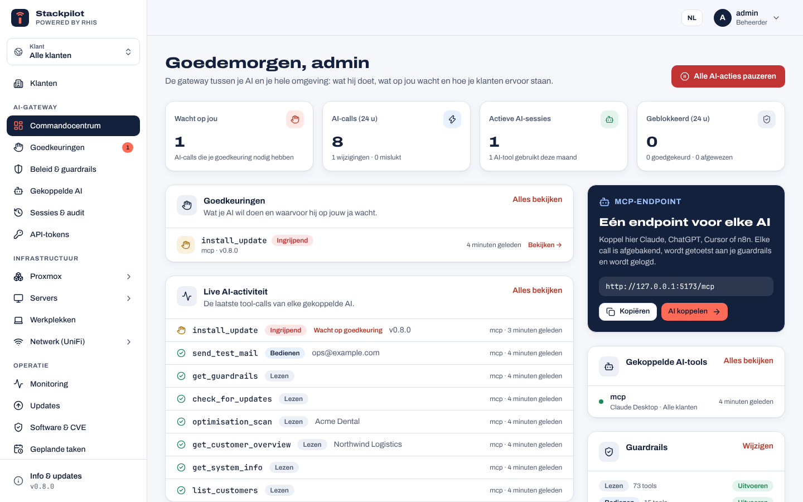
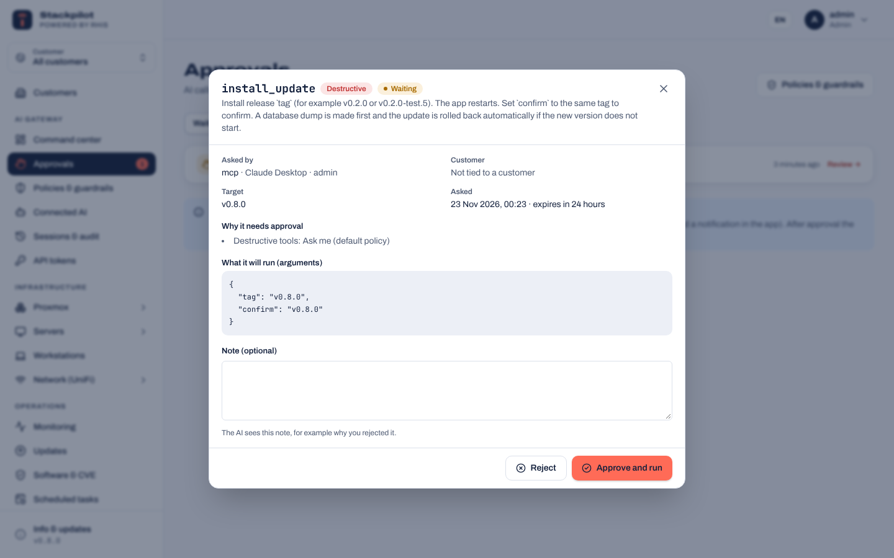
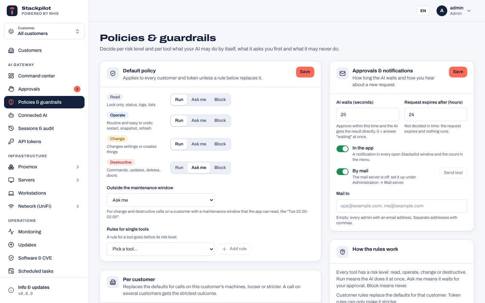
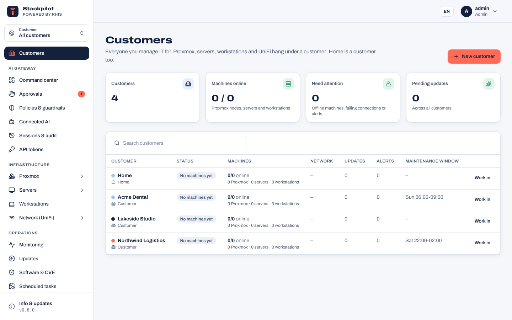
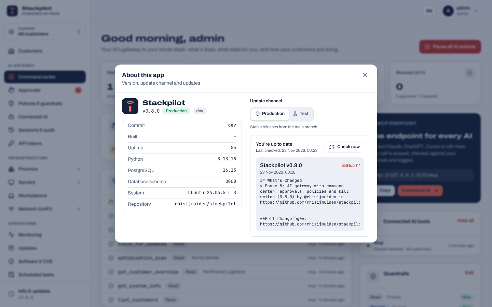
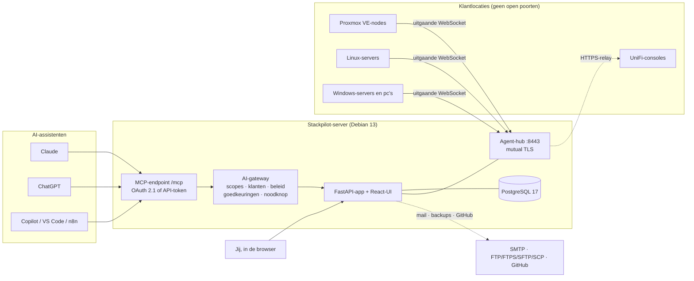

<p align="center">
  
</p>

<h1 align="center">Stackpilot</h1>

<p align="center">
  <strong>De AI-gateway voor je hele IT-omgeving.</strong><br>
  Eén plek om de Proxmox-clusters, Linux- en Windows-servers, werkplekken en UniFi-netwerken van al je klanten te
  beheren, en één MCP-endpoint waarmee Claude, ChatGPT of Copilot het werk doet: afgebakend, bewaakt, goedgekeurd en
  gelogd.
</p>

<p align="center">
  <a href="https://github.com/rhisijmuiden/stackpilot/releases/latest"></a>
  <a href="https://github.com/rhisijmuiden/stackpilot/actions/workflows/release.yml"></a>
  
  
  
</p>

<p align="center">
  <a href="#functies">Functies</a> ·
  <a href="#hoe-het-werkt">Hoe het werkt</a> ·
  <a href="#snel-starten">Snel starten</a> ·
  <a href="docs/features.md">Functiegids (EN)</a> ·
  <a href="docs/mcp-tools.md">MCP-toolreferentie (EN)</a> ·
  <a href="#roadmap">Roadmap</a> ·
  <a href="README.md">English</a>
</p>



## Waarom Stackpilot

Een AI-assistent servers laten beheren betekent meestal een losse sessie per machine, geen overzicht en geen rem.
Stackpilot draait dat om: een kleine agent op elke machine maakt een **uitgaande** verbinding met één server, en die
server geeft je AI **één MCP-endpoint** voor alles. Jij bepaalt per risiconiveau, per klant en per token wat de AI zelf
mag, waarvoor hij eerst moet vragen en wat nooit mag. Elke call komt in het auditlog, en met één knop pauzeer je alle
AI-acties.

- **Klanten centraal.** Alles hangt onder een klant, zodat een MSP of zelfstandig beheerder elke klant gescheiden
  houdt, tot en met tokens die maar één klant zien.
- **Geen open poorten bij klanten.** Agents gebruiken uitgaande WebSockets met mutual TLS; console, bestanden kopiëren
  en UniFi-calls lopen over diezelfde verbinding.
- **Native en licht.** Python 3.13 (FastAPI), PostgreSQL 17 en Nginx op Debian 13, Go-agents. Geen Docker.
- **Engels en Nederlands**, licht en donker thema, in de RHIS-huisstijl.

## Functies

| | |
| --- | --- |
| 🤖 **AI-gateway** | Commandocentrum, goedkeuringen-inbox (app + mail), beleid per risiconiveau, klant en token, onderhoudsvensters, noodknop, AI-sessies en activiteitenlog. |
| 🧰 **232 MCP-tools** | Logs lezen, services herstarten, commando's uitvoeren, patchen, VM's, netwerk, HA, deploys en UniFi beheren, alles via één endpoint met OAuth 2.1 of API-tokens. [Volledige lijst](docs/mcp-tools.md). |
| 💻 **Werkplekken** | Pc's en laptops per klant: hardware, OS, aangemelde gebruiker, geïnstalleerde software, schijven en SSD-slijtage, Windows Update-geschiedenis, Defender, BitLocker/LUKS, firewall, TPM, een beveiligingsstatus, en acties op afstand (Defender-scan, definities bijwerken, groepsbeleid vernieuwen, bericht, afmelden). |
| 📄 **Maandrapporten** | Eén rapport per klant per maand (PDF en HTML): uitgevoerde werkzaamheden met duur en resultaat, beschikbaarheid, incidenten, updates, Proxmox-back-ups, beveiliging van werkplekken, AI-acties en aanbevelingen, op een vaste dag gemaild naar de klant of op verzoek gemaakt. |
| 🏢 **Klanten** | Klantkiezer, klantpagina met Proxmox, servers, werkplekken, netwerk en AI-toegang, contactpersonen, notities voor de AI, onderhoudsvenster, SLA en een optimalisatiescan. |
| 🖥️ **Proxmox VE** | Nodes, VM's en containers, console in de browser (noVNC / xterm.js), snapshots, migratie, aanmaken vanuit templates, community scripts, ISO of cloud image, CT-templatebibliotheek die naar alle nodes synct. |
| 🌐 **Netwerk & cluster** | Bridges en VLAN's met gebruiksoverzicht, wijzigingen eerst als diff met automatische rollback, firewall, SDN-ontwerper, HA, replicatie, backupjobs en storage. |
| 🧑‍💻 **Linux- & Windows-servers** | Dezelfde agent op elke Linux-server of Windows Server/pc (MSI): services, journal/Event Log, pakketten en Windows Update, shell/PowerShell, bestanden, gezondheidscheck. |
| 🔎 **Troubleshooten** | Logs doorzoeken op veel servers tegelijk, foutoverzichten, software- en CVE-inventaris, data kopiëren tussen servers. |
| 📶 **UniFi** | UniFi Network, Site Manager en Access: apparaten, clients, wifi-troubleshooter, gastisolatiecheck, firmware, events, deuren en toegangslog. |
| 📈 **Monitoring** | Eén meting per node per minuut, 30 dagen bewaard, trends, SMART en slijtage, alerts per mail. |
| ☁️ **Microsoft 365 & Entra ID** | Koppel de tenant van een klant met een app-registratie (clientgeheim of certificaat, bewaard in de wachtwoordkluis). Gebruikers met licenties, beheerdersrollen, MFA en Entra ID-risico, gekochte en toegewezen licenties, standaardbeveiliging en voorwaardelijke toegang, en de aanmeldingen die opvallen (risicovol, mislukt, vanuit een ander land, oude protocollen). Meldingen en bevindingen in de ochtendsamenvatting voor risicovolle gebruikers, beheerders zonder MFA, inactieve of geblokkeerde accounts met licentie, licentietekorten en een app-geheim dat verloopt. Blokkeren, afmelden, MFA of wachtwoord resetten vanuit de app; de AI alleen na goedkeuring van een beheerder. |
| 📚 **Documentatie & wachtwoordkluis** | Netwerkplannen, procedures, notities en contactpersonen per klant in Markdown, met versies, versleutelde bijlagen en gekoppelde machines; de AI leest ze voordat hij aan een klant werkt. Een wachtwoordkluis per klant (AES-256-GCM, eigen sleutel, sleutelrotatie, wachtwoordgeschiedenis, generator): mensen zien geheimen na het opnieuw invoeren van hun wachtwoord, de AI pas nadat een beheerder dat ene gebruik heeft goedgekeurd, of hij draait een script met het geheim zonder het zelf te zien. Elk tonen, kopiëren en gebruik staat in het toegangslog. |
| 🎫 **Klantportaal & tickets** | Klanten loggen in op hun eigen portaal, melden problemen en vragen, koppelen die aan hun computers en servers en volgen de status. Stackpilot voert meteen een eerste diagnose uit op die machines; medewerkers antwoorden, maken interne notities, wijzen toe en lossen op, met mails via je eigen SMTP-server. De AI leest en beantwoordt tickets via MCP. |
| 📡 **Uptime & SLA** | Externe controles per klant van websites (status, trefwoord, reactietijd, certificaat), TCP-poorten, ping, DNS-records en VPN-endpoints, vanaf Stackpilot of vanaf een machine bij de klant; storingen, meldingen en de gemeten SLA tegenover het doel van elke klant in het maandrapport. |
| 🔐 **Certificaten, firewall & VPN** | Elk certificaat van een klant, van websites en mailservers tot de certificaatopslag op Linux, Proxmox en Windows, met waarschuwingen voordat het verloopt. Elke firewallwijziging (Proxmox, nftables/iptables, Windows Firewall, UniFi) als diff die iemand moet bevestigen, en VPN-tunnels (WireGuard, IPsec, OpenVPN, Windows RRAS, UniFi) die een melding geven als ze down blijven. |
| 🗓️ **Wijzigingskalender** | Plan onderhoud en wijzigingen per klant, gecontroleerd tegen het onderhoudsvenster, andere wijzigingen en geplande taken, met het eerstvolgende vrije moment als voorstel. De klant krijgt vooraf een melding (standaard 3 dagen en 1 uur), bij verplaatsen of annuleren, en achteraf, ziet het in het portaal en kan zich abonneren op een iCal-feed. |
| 💶 **Kosten & licenties** | Wat elke klant per maand kost als basis voor de facturatie: resources en machines volgens je prijslijst, Microsoft 365-licenties, contracten, licenties en hardware, met een pdf/csv-overzicht per maand en waarschuwingen voordat een contract, licentie of garantie afloopt of opgezegd moet worden. |
| ⏱️ **Geplande taken** | Updates van containers en nodes, template-sync of een eigen commando op een cron-schema, met snapshot vooraf, rollback en mailrapport. |
| 🚀 **Deploys vanuit GitHub** | Een repo uitrollen in een container (prod/test-branch), bij elke push via webhook of door te pollen, met snapshot vooraf en herstel bij fouten. |
| 🌅 **Nachtelijke controle & ochtendsamenvatting** | Elke nacht wordt elke klant gecontroleerd: updates, beveiligingsupdates met de CVE's die ze verhelpen, volle schijven, verlopende certificaten, mislukte of ontbrekende back-ups en de optimalisatiescan. 's Ochtends één samenvatting in de app en per mail, met wat nieuw en opgelost is, en voorstellen die je met één klik goedkeurt; wijzigingen wachten op het onderhoudsvenster van de klant. |
| 📒 **Runbooks** | Vaste procedures per klant of voor iedereen (server patchen, nieuwe medewerker, nieuw project via GitHub, service herstarten) die Stackpilot stap voor stap uitvoert met zijn eigen tools: goedkeuring per stap waar het beleid of het runbook dat zegt, wachten op het onderhoudsvenster, handmatige stappen voor een persoon of de AI, en elke stap in het auditlog. Bewerken in de app, of de AI start ze via MCP. |
| 💓 **Automatisch herstel** | Bekende problemen lossen zichzelf op binnen het beleid: een gestopte service wordt herstart, een volle schijf opgeruimd, een offline agent in een VM of container teruggebracht. Regels per klant koppelen een alert of een nachtelijke bevinding aan een runbook; het probleem moet echt weg zijn voordat het als opgelost telt. Afkoeltijd, een maximum aantal pogingen, een limiet per uur, een stroomonderbreker en één noodknop; een Proxmox VE-node wordt nooit herstart. Resultaten in de app, per mail, in de ochtendsamenvatting en in het maandrapport. |
| 🛟 **Back-ups van klanten** | Dekking per klant: welke VM's, containers, servers en werkplekken een back-up hebben, wanneer de laatste goede liep, grootte, fouten, verify en offsite kopie. Meldingen als een back-up mislukt of ouder is dan de SLA van de klant, terugzetten van een hele guest of losse bestanden (Proxmox Backup Server) met goedkeuring, status van Windows Server Backup, en beheer van datastores, verify-, sync- en prune-jobs op Proxmox Backup Server. |
| 💾 **App-back-ups** | Full en incremental, versleuteld (AES-256-GCM), naar FTP, FTPS, SFTP of SCP, ingepland, met restore vanaf de remote locatie. |
| ✉️ **Mailserver** | Je eigen SMTP-server met STARTTLS of TLS, minimaal TLS 1.2/1.3 en DKIM-ondertekening, voor alerts, goedkeuringen en rapporten. |
| 🔄 **Updaten vanuit de app** | Info & updates toont de versie, controleert GitHub, wisselt tussen productie (`main`) en test (`test`) en installeert, met databasebackup en automatische rollback. |

Elke functie staat uitgebreid beschreven in de **[functiegids](docs/features.md)** (Engels).

## Een kijkje binnen

| Keur goed wat ertoe doet | Bepaal wat de AI mag |
| --- | --- |
|  |  |
| **Al je klanten in één overzicht** | **Versie, kanaal en updates** |
|  |  |

*Screenshots van een demo-installatie met fictieve klanten. De interface is volledig in het Nederlands te gebruiken;
kies de taal rechtsboven.*

## Hoe het werkt



1. **Een AI roept een tool aan** op het MCP-endpoint met zijn OAuth-koppeling of API-token.
2. **De gateway controleert** de scopes en klanten van het token, daarna het beleid voor het risiconiveau van de tool
   (lezen, bedienen, wijzigen, ingrijpend), het onderhoudsvenster van de klant en de noodknop.
3. **Uitvoeren, wachten of stoppen.** Toegestane calls draaien meteen. Calls die goedkeuring nodig hebben antwoorden
   `pending_approval`; jij krijgt een mail en een melding in de app, en na jouw akkoord voert Stackpilot de call zelf
   uit met de rechten van het token. Geblokkeerde calls worden geweigerd.
4. **De agent doet het werk** op de machine via zijn uitgaande verbinding, en het resultaat met alle argumenten komt
   in het AI-activiteitenlog.

Meer in [architectuur](docs/architecture.md) (Engels).

## Snel starten

Op een schone **Debian 13**-server of LXC-container:

```bash
curl -fsSL https://raw.githubusercontent.com/rhisijmuiden/stackpilot/main/deploy/install.sh | sudo bash
```

De installer toont het adres en een eenmalige **setupcode**. Open het adres, maak de eerste beheerder aan en daarna:

1. Maak een klant aan onder **Klanten** (Home staat er al).
2. Voeg vanaf de klantpagina een machine toe: **Proxmox VE-node**, **server** of **werkplek**. Kopieer het
   installatiecommando met de koppelcode naar de machine.
3. Kopieer onder **AI-gateway → Gekoppelde AI** het MCP-endpoint en koppel Claude, ChatGPT of Copilot
   (**Help → Claude, ChatGPT of Copilot koppelen** legt het stap voor stap uit).
4. Controleer **Beleid & guardrails**, stel een **mailserver** en een **backuplocatie** in.

Testkanaal, achter een reverse proxy, sub-paden, agents op Windows en alle installeropties:
zie **[installatie](docs/install.md)** (Engels).

## Documentatie

| Document | Inhoud |
| --- | --- |
| [Functiegids](docs/features.md) | Elk onderdeel van de app, pagina voor pagina |
| [MCP-toolreferentie](docs/mcp-tools.md) | Alle 232 tools met risiconiveau, scope en parameters (gegenereerd uit de code) |
| [Installatie](docs/install.md) | Installeren, upgraden, reverse proxy (Zoraxy), agents, bestandslocaties, ontwikkelen |
| [Architectuur](docs/architecture.md) | Onderdelen, agentprotocol, beveiligingsmodel |
| [Releasegeschiedenis](docs/history.md) | Wat elke fase en release toevoegde |
| [Huisstijl](branding/huisstijlgids.md) | RHIS-logo, kleuren en typografie |

## Roadmap

| Fase | Onderwerp | Status |
| --- | --- | --- |
| 1–6 | Fundament, Proxmox, VM's en containers, netwerk/HA/deploys, Linux- en Windows-servers, UniFi | ✅ Klaar |
| 7 | Klanten centraal | ✅ Klaar (v0.7.0) |
| 8 | AI-gateway: commandocentrum, goedkeuringen, beleid, noodknop | ✅ Klaar (v0.8.0) |
| 9 | **MCP-hub**: andere MCP-servers registreren (Keystone VoIP, GitHub) en hun tools doorgeven met dezelfde authenticatie, beleid en audit; toolcatalogus met aan/uit per tool en token | ✅ Klaar (v0.9.0) |
| 10 | **Werkplekken en maandrapport**: inventaris en beveiligingsstatus per pc (Defender, BitLocker, patches, schijven, software), acties op afstand, maandrapport per klant als PDF gemaild naar de contactpersonen | ✅ Klaar (v0.10.0) |
| 11 | **Back-upbeheer per klant**: dekking, meldingen per SLA, terugzetten met goedkeuring, Proxmox Backup Server, Windows Server Backup, back-ups in het maandrapport en de optimalisatiescan | ✅ Klaar (v0.11.0) |
| 12 | **Nachtelijke controle en ochtendsamenvatting**: elke nacht updates, CVE's, schijven, certificaten en back-ups van elke klant, 's ochtends één samenvatting met voorstellen die je met één klik goedkeurt en die in het onderhoudsvenster draaien | ✅ Klaar (v0.12.0) |
| 13 | **Runbooks**: vaste procedures stap voor stap uitgevoerd via de tools van Stackpilot, met goedkeuring per stap, het onderhoudsvenster en het auditlog, bewerkbaar in de app en beschikbaar als MCP-tools | ✅ Klaar (v0.13.0) |
| 14 | **Automatisch herstel**: regels die alerts en nachtelijke bevindingen koppelen aan herstel-runbooks, uitgevoerd binnen het beleid met controle achteraf, lusbeveiliging, een stroomonderbreker en een noodknop | ✅ Klaar (v0.14.0) |
| 15 | **Netwerkherstel en Windows-scripts**: een netwerkkaart of uplink zonder link wordt herstart (ook door de agent zelf als die Stackpilot niet bereikt), en geplande taken draaien PowerShell-scripts op Windows-machines | ✅ Klaar (v0.15.0) |
| 16 | **Uptime- en SLA-monitoring**: externe controles van websites, VPN's en poorten, SLA-percentage per klant in het maandrapport | ✅ Klaar (v0.16.0) |
| 17 | **Klantportaal met tickets**: klanten melden problemen in hun eigen portaal, tickets gekoppeld aan machines, met een eerste diagnose door de AI | ✅ Klaar (v0.17.0) |
| 18 | **Documentatie en wachtwoordkluis per klant**: de AI gebruikt geheimen alleen na goedkeuring, elk gebruik in het auditlog | ✅ Klaar (v0.18.0) |
| 19 | **Microsoft 365 / Entra-beheer**: gebruikers, licenties, MFA-status en riskante aanmeldingen per klant | ✅ Klaar (v0.19.0) |
| 20 | **Certificaat-, firewall- en VPN-bewaking**: verloopdatums, configuratiewijzigingen en tunnels die wegvallen | ✅ Klaar (v0.20.0) |
| 21 | **Kosten en licenties per klant**: prijslijst, resourcegebruik, licenties, contracten en hardware met verlengdatums, maandoverzicht met CSV/PDF-export | ✅ Klaar (v0.21.0) |
| 22 | **Wijzigingskalender per klant**: geplande wijzigingen en onderhoud, gecontroleerd tegen het onderhoudsvenster, met meldingen aan de klant vooraf en achteraf, het portaal en een iCal-feed | ✅ Klaar (v0.22.0) |

## Releases en kanalen

- `main` → productiereleases `vX.Y.Z`
- `test` → testbuilds `vX.Y.Z-test.N` (prereleases)

Wissel van kanaal en update via **Info & updates** onderaan het menu.

## Ontwikkelen

Zie [installatie → development](docs/install.md#development) (Engels).
