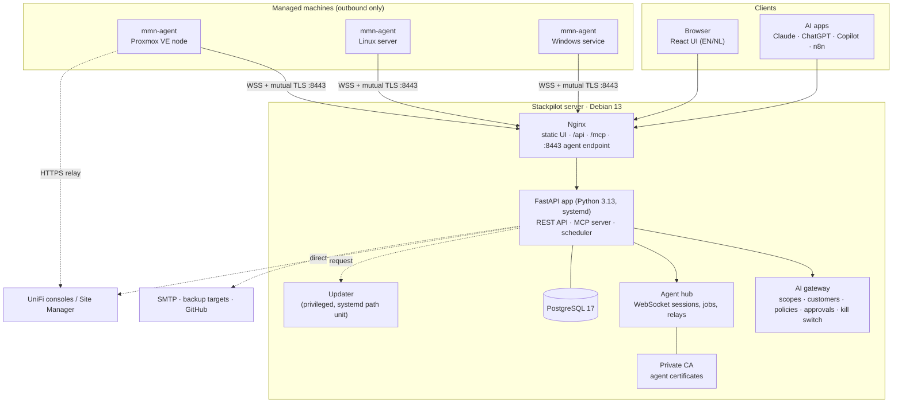
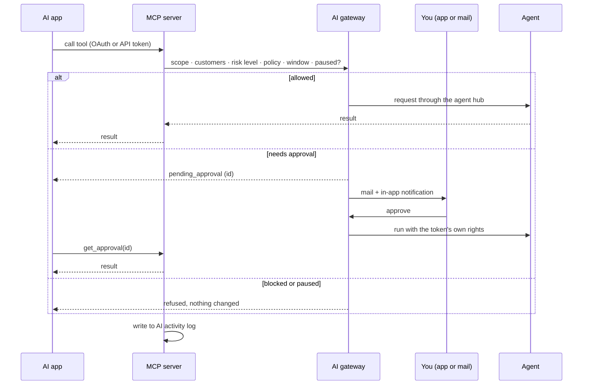

# Architecture

[← Back to the README](../README.md)

## Overview

| Part | Technology | Where |
| --- | --- | --- |
| Web app and API | FastAPI on Python 3.13, SQLAlchemy (async), Alembic migrations | [`backend/mmn`](../backend/mmn) |
| MCP server | Streamable HTTP at `/mcp`, OAuth 2.1 (dynamic client registration, PKCE) or API tokens | [`backend/mmn/mcp_server.py`](../backend/mmn/mcp_server.py) |
| AI gateway | Risk levels, policies, approvals, kill switch | [`backend/mmn/services/gateway.py`](../backend/mmn/services/gateway.py) |
| Interface | React + TypeScript + Tailwind, built to static files (no Node on the server), English and Dutch | [`frontend`](../frontend) |
| Database | PostgreSQL 17 | |
| Web server | Nginx: serves the UI, proxies the API, MCP and WebSockets, terminates the agents' mutual TLS | [`deploy`](../deploy) |
| Agent | Go, no dependencies; `.deb`, binary, Windows `.exe` and `.msi` | [`agent`](../agent) |
| Install and updates | `install.sh`, release tarballs with SHA-256, privileged updater with rollback | [`deploy`](../deploy) |

## The agent

- **Enrollment.** A pairing code (valid 24 hours) is exchanged once for a client certificate signed by the app's own
  CA. The install script pins the CA fingerprint, so the agent only ever talks to your server.
- **Connection.** One outgoing WebSocket over mutual TLS to `<address>:8443`, kept alive with pings and reconnected
  with exponential backoff (1 to 60 seconds). Machines need no open ports, no VPN and no port forwards.
- **Protocol.** JSON envelopes: the agent sends `hello`, `metrics`, `updates`, `res` and `job` progress; the app sends
  `req` with a method and parameters. Long tasks (updates, scripts, copies) stream their output line by line and are
  delivered after a reconnect.
- **What it does.** System info and metrics, package updates (apt, dnf/yum, Windows Update), services, logs (journal,
  event log, files), commands (shell or PowerShell), files, SMART, CPU governor, Proxmox API calls on the node, the
  console relay, data transfer between agents, log search, and an HTTPS relay to UniFi consoles in the same network.
- **Self-update.** Agents update themselves to the version bundled with the app (can be turned off). On Windows the
  service restarts itself cleanly after an update.

## A tool call, step by step

## Security model

- **People**: Argon2id password hashes, sign-in rate limiting, secure session cookies with CSRF protection, roles
  admin and viewer, password reset by mail.
- **AI and scripts**: OAuth 2.1 or API tokens with explicit scopes and optional customer binding; the customer filter
  is enforced in the database layer for every tool. Powerful scopes can only be granted by admins.
- **Guardrails**: risk levels, policies per customer and token, maintenance windows, approvals and the kill switch.
  Destructive tools require the exact target as confirmation; commands and service actions need a stated reason.
- **Secrets**: SMTP, backup, UniFi and GitHub credentials and the DKIM key are encrypted at rest (Fernet) and never
  shown again after saving. Backups can be encrypted with AES-256-GCM.
- **Machines**: mutual TLS with the app's own CA and a pinned fingerprint; UniFi consoles with self-signed
  certificates are pinned by SHA-256 before an API key is sent.
- **Changes on nodes**: network and SDN changes back up the config first and roll back automatically when the node
  is no longer reachable or the reload fails; scheduled tasks and deployments take a snapshot first.
- **Audit**: every sign-in, change and AI call is logged with user or token, target, arguments and outcome.
