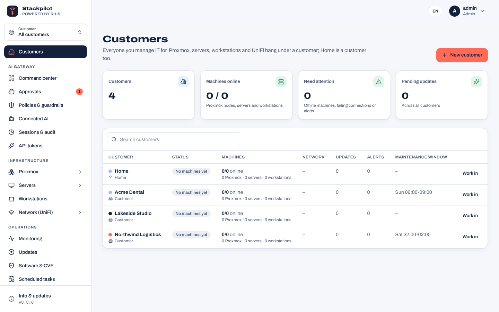
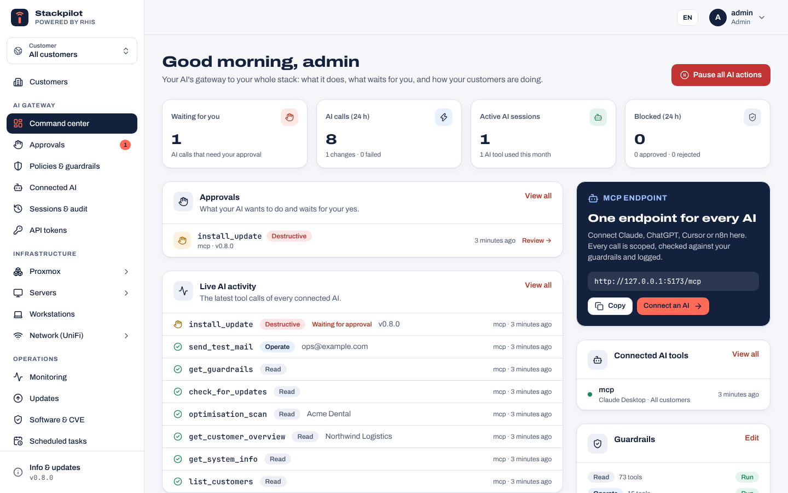
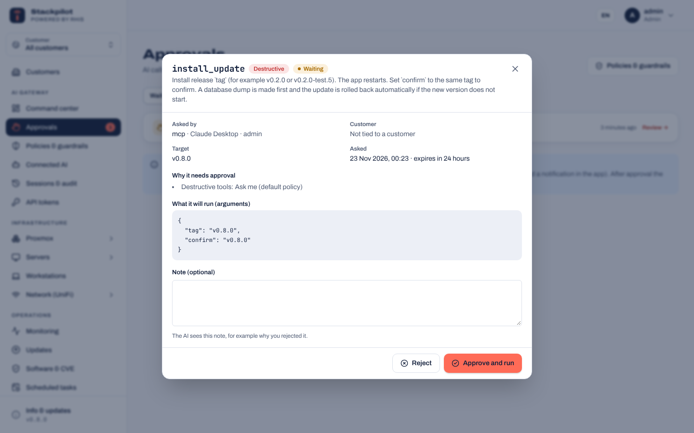
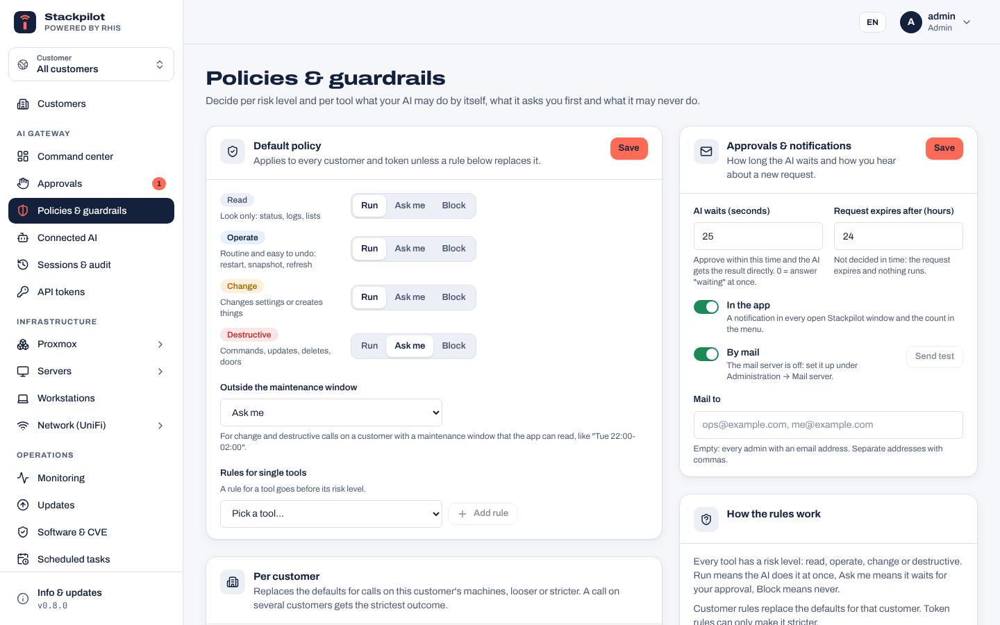
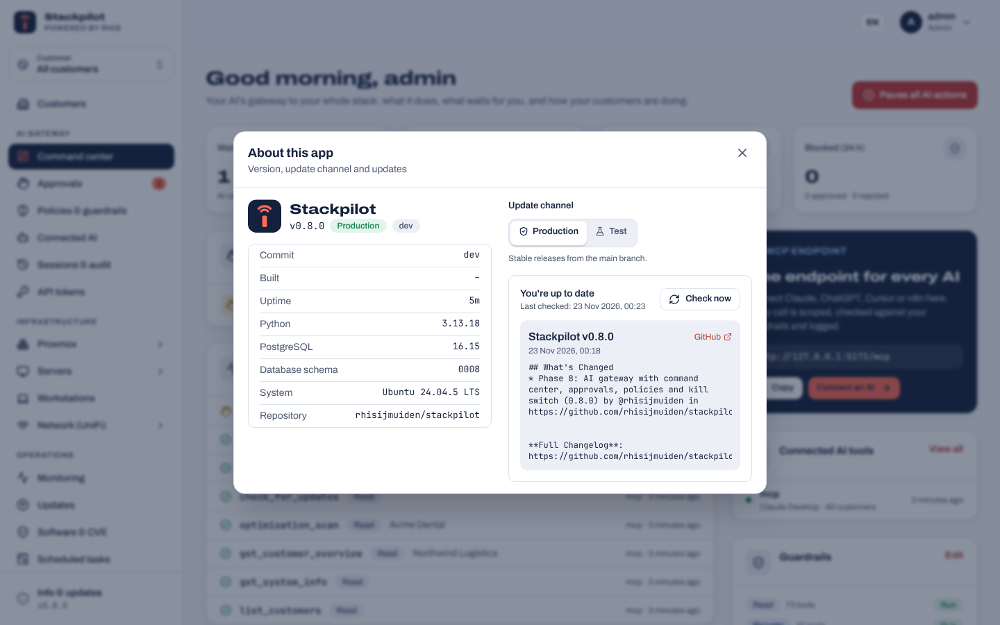

# Feature guide

[← Back to the README](../README.md) · [MCP tool reference](mcp-tools.md) · [Installation](install.md)

This guide follows the menu on the left of the app. Everything you can do in the interface, an AI assistant can do
through the [MCP tools](mcp-tools.md), within the limits you set.

- [Customers](#customers)
- [AI gateway](#ai-gateway)
  - [Command center](#command-center) · [Approvals](#approvals) · [Policies & guardrails](#policies--guardrails) ·
    [Connected AI and API tokens](#connected-ai-and-api-tokens) · [Sessions & audit](#sessions--audit) ·
    [The MCP server](#the-mcp-server)
- [Infrastructure](#infrastructure)
  - [Proxmox nodes](#proxmox-nodes) · [VMs and containers](#vms-and-containers) · [CT templates](#ct-templates) ·
    [Network, firewall and SDN](#network-firewall-and-sdn) · [Cluster & HA](#cluster--ha) ·
    [Linux and Windows servers](#linux-and-windows-servers) · [Workstations](#workstations) · [UniFi](#unifi)
- [Operations](#operations)
  - [Monitoring](#monitoring) · [Updates](#package-updates) · [Software & CVE](#software--cve) ·
    [Scheduled tasks](#scheduled-tasks) · [Deployments from GitHub](#deployments-from-github)
- [Administration](#administration)
  - [Agents & pairing](#agents--pairing) · [Users](#users) · [Backups](#backups) · [Mail server](#mail-server) ·
    [Notifications](#notifications) · [Web server & proxy](#web-server--proxy) · [Audit log](#audit-log) ·
    [General](#general)
- [Info & updates](#info--updates)
- [Interface, languages and security](#interface-languages-and-security)

---

## Customers

Customers are the top layer: every Proxmox node, server, workstation and UniFi connection belongs to one. *Home* is a
customer too, for your own environment.

- **Customers** lists every customer with status, machines online, network, pending updates, alerts and the
  maintenance window.
- The **customer switcher** at the top of the menu limits every page of the app to one customer.
- Each **customer page** has the tabs Overview, Proxmox, Servers, Workstations, Network, AI access, Contacts & notes
  and Reports. **Add machine** adds a Proxmox VE node, a server or a workstation straight to that customer; existing
  machines can be moved under **Manage** on the machine's page.
- **Contacts & notes** holds contact details, contacts, an SLA, a maintenance window (for example `Sat 22:00-02:00`)
  and notes for the AI ("never restart the SQL server during office hours"). The AI gets these notes before it works
  on that customer, through `get_customer_overview`, `get_customer_context` and the MCP resource
  `stackpilot://customers/<id>`.
- **Optimisation scan** answers "what can be improved at this customer?" in one go: capacity (memory per node and
  the balance inside a cluster, with a guest to move), storage and SMART health, full disks, pending updates and
  reboots, old agents, failed services, stopped guests, UniFi devices offline, firmware updates and whether the guest
  WiFi is isolated from the LAN. Findings come by severity with a suggestion and the tool to use next. In the app and
  as the MCP tool `optimisation_scan`.
- **AI access** ties tokens and connected AI apps to customers. A token with *Only these customers* only sees those
  customers' machines, UniFi connections, jobs and alerts, enforced in the database layer for every tool. Tools that
  work on the whole app (app updates and backups, mail server, audit log, template library, scheduled tasks) are then
  refused.

## AI gateway

Stackpilot sits between your AI and your infrastructure. Every MCP call passes the same checks: scope, customers,
policy, maintenance window and kill switch, and ends up in the activity log.

### Command center

The start page. It shows what waits for you (pending approvals), AI calls in the last 24 hours with changes and
failures, active AI sessions, blocked calls, the **live AI activity** feed, the MCP endpoint with a copy button,
connected AI tools, the current guardrails per risk level and the reach and health of every customer.

**Pause all AI actions** is the kill switch: from that moment every tool call that changes something is refused until
you resume. It can also be set per customer or per token.

### Approvals

A call that needs approval is not run. It is stored in **Approvals** and the AI gets the answer `pending_approval`
with an id. You get a mail and an in-app notification. The request shows the tool and its description, who asked
(token or AI app and user), the customer, the target, why it needs approval and the exact arguments. Add a note (the
AI sees it) and **Approve and run** or **Reject**.

After approval, Stackpilot runs the call itself with the token's own rights; the AI reads the outcome with
`get_approval`. The AI can wait a few seconds for a quick approval and gets the result straight away. Requests that
are not decided in time expire and nothing runs (both timings are set under Policies).

### Policies & guardrails

Every MCP tool has a **risk level**:

| Risk | Meaning | Default |
| --- | --- | --- |
| Read | Look only: status, logs, lists | Run |
| Operate | Routine and easy to undo: restart a service, take a snapshot, refresh | Run |
| Change | Changes settings or creates things | Run |
| Destructive | Commands, updates, reboots, deletes, doors | Ask me |

For each risk level, and for single tools, you choose **Run**, **Ask me** or **Block**:

- **Default policy** for every customer and token.
- **Per customer**, looser or stricter than the default. A call that touches several customers gets the strictest
  outcome.
- **Per token**, which can only make it stricter.
- **Outside the maintenance window**: change and destructive calls on a customer with a maintenance window ask for
  approval by default (or are ignored or blocked, your choice).
- A call with `dry_run` counts as read, so the AI can always show what it would change first.

Under **Approvals & notifications** you set how long the AI waits, when a request expires, and whether you are told in
the app and by mail (and to which addresses).

### Connected AI and API tokens

- **Connected AI** shows the MCP endpoint and every AI app connected through OAuth (Claude, ChatGPT, VS Code and
  others), with its customers and last use. Disconnect an app or limit it to some customers.
- **API tokens** are personal tokens for scripts and tools such as n8n. Choose the scopes, an expiry and optionally
  the customers. The token is shown once.

Scopes keep a connection to what it needs: read, backups, restore, updates, settings, nodes, node updates, logs,
services, exec, copy, guests, guests admin, templates, scheduled tasks, network, cluster, deployments, UniFi read,
UniFi actions and doors. See [scopes](mcp-tools.md#scopes).

### Sessions & audit

**Sessions & audit** groups AI calls into sessions (same AI tool, no pause longer than 30 minutes) over the last
24 hours, 7 or 30 days. Pick a session to see every call with its arguments, outcome and duration, and whether it
waited for approval or failed. Together with the app's [audit log](#audit-log) you can always see
who, or which AI, did what.

### MCP hub

**MCP hub** brings your other MCP servers behind the same endpoint, so your AI needs one connection for
everything: Keystone (VoIP), GitHub, Home Assistant or any other MCP server.

- **Connect** over Streamable HTTP (directly, or **through an agent** in the customer's network, so a server on the
  LAN needs no open port), the older HTTP + SSE transport, or as a **command** that Stackpilot starts itself (stdio,
  for example `github-mcp-server stdio`). Certificates can be checked, pinned or (not recommended) ignored.
- **Sign-in per server**: a bearer token, your own headers (API key) or **OAuth** (you sign in once, Stackpilot keeps
  and renews the tokens). Every secret is stored encrypted.
- **Prefix per server**: tools appear as `<prefix>__<tool>`, for example `github__create_issue` or
  `keystone__list_calls` (Claude and most AI tools do not accept a dot in tool names).
- **You accept tools first.** A new or changed tool (name, description, parameters or hints) is withdrawn until you
  accept it again, so a server can't quietly slip new instructions to your AI ("tool poisoning").
- **Same rules**: every tool gets a risk level, suggested from the server's own `readOnlyHint` / `destructiveHint`
  and adjustable, and goes through the same policies, approvals, maintenance windows, kill switch and audit log. A
  server can belong to a customer: only tokens for that customer see it and its calls follow that customer's
  policies. Shared servers (GitHub) are only for tokens for all customers.
- **Access**: an AI connection or token needs the `hub` scope; switch it on per AI app on the MCP hub page.
- **Health**: status, tool count, response time and the last error per server, checked every 5 minutes. New tools
  are written to the audit log.
- **Ready-made**: **GitHub** (the official GitHub MCP server, with a fine-grained token or GitHub App with minimal
  permissions) to run projects from A to Z: repository, issues, pull requests, releases and Actions, then deploy into a
  container with [Deployments](#deployments-from-github). **Keystone** for the VoIP central, through an agent.

### Tool catalog

**Tool catalog** lists every tool your AI can get, from Stackpilot itself and from the MCP hub, with its risk
level. Switch single tools or a whole MCP hub server off for every token, or for one token. A switched-off tool is
not shown to the AI and calls are refused (stored as a "block" rule, so it also shows on Policies & guardrails).

### The MCP server

- Endpoint `https://<your address>/mcp`, Streamable HTTP.
- **OAuth 2.1** with dynamic client registration and PKCE for Claude, ChatGPT and VS Code, or a personal **API token**
  for scripts.
- **135 tools** across customers, Proxmox, servers, network, cluster, monitoring, deployments, UniFi, backups, updates
  and the gateway itself. See the **[MCP tool reference](mcp-tools.md)**.
- Destructive tools require confirmation of the exact target, commands and service actions need a stated reason, and
  network changes can be tried as a dry run first.
- **Help → What the MCP can do** lists everything in the app; **Help → Connect Claude, ChatGPT or Copilot** has
  step-by-step instructions.

Examples of what you can ask:

- "Check customer Northwind: anything that needs attention?"
- "Why is the web server on pve2 slow? Look at the logs and restart nginx if needed."
- "Which servers still run an nginx version with a known CVE?"
- "Install the pending updates on all nodes of Acme during the maintenance window."
- "Why can't this laptop get on the WiFi?" · "Who opened the server room last night?"

## Infrastructure

### Proxmox nodes

Every Proxmox VE node runs the Stackpilot agent. **Proxmox → Overview** shows all nodes with status, CPU, RAM, disk,
guests and available updates. Per node:

- Package updates (refresh, install, reboot), with a live job log.
- **CPU governor** per node (for example `powersave` or `performance`).
- Proxmox notification settings (SMTP) pushed from the customer to every node, with a test notification.
- Server administration through the agent: logs and journal, services, packages, files, commands and a node shell in
  the browser.
- Agent version and self-update.

### VMs and containers

- **Proxmox → VMs & containers** lists every guest of every node (reported by the agents every 20 seconds). Per guest:
  start, shut down, stop, reboot, snapshots (take, roll back, delete), migrate within the cluster, CPU/memory/tags,
  delete, and the **console**, inline or in its own tab (VMs via noVNC with Ctrl+Alt+Del, containers via xterm.js).
- **Create** offers a container from the template library, a **community script** from community-scripts.org (the
  script is shown first and runs as root on the chosen node; default or interactive mode), a VM from an ISO (existing
  or downloaded) and a VM from a **cloud image** with cloud-init. The node defaults to the least loaded one.
- The console is relayed by the app: the browser connects to the app, the app to the agent's outgoing connection, so
  nodes need no open ports.

### CT templates

One list of official (pveam) and custom templates (uploaded or downloaded, stored in the app and its backups), with
per node whether each one is current, outdated or missing. **Push to all nodes** and the nightly task place them on
every node.

### Network, firewall and SDN

- **Proxmox → Network** shows every bridge with the VMs and containers on it, grouped by VLAN tag, plus SDN VNets and
  bridges guests point to that don't exist.
- Bridge changes are **staged** first and shown as a diff of `/etc/network/interfaces`. Applying needs the node name
  typed in; the node backs up the file, reloads, and **restores the old file by itself** when the app can't reach it
  again within 90 seconds.
- The **firewall** tab covers cluster, node and guest rules and options.
- The **SDN designer** builds a zone in five steps (zone, VNets, subnets, nodes, review) with a live preview that
  marks what is new or changed. Rolling out backs up `/etc/pve/sdn/*.cfg` first and restores it automatically when the
  reload fails. Every backup can be restored with one click under **Network → Config backups**.

### Cluster & HA

HA resources and rules (or groups on older Proxmox versions), storage replication, the cluster's own backup jobs
(vzdump) and storage (directory, NFS, SMB/CIFS, Proxmox Backup Server).

### Linux and Windows servers

The same agent runs on stand-alone servers:

- **Linux**: Debian, Ubuntu, RHEL/Rocky/Alma, Fedora, SUSE, Alpine.
- **Windows**: Server 2016+ and Windows 10+, as a Windows service with an MSI installer (also silent for GPO, Intune or
  an RMM).

Per server: services (systemd or Windows services), journal or event log, health check, installed software, updates
(apt, dnf/yum or Windows Update), a shell or PowerShell in the browser, commands and files.

Across servers, for people and AI:

- **Log search** on many servers at once, and error overviews.
- **Software & CVE**: which servers have a package or version (for example nginx for a CVE).
- **Data copy** from one server to another, agent to agent through the app, so the servers don't need to reach each
  other (the size limit is set under Agents & pairing).

### Workstations

Linux and Windows machines can be marked as **workstation** (PC or laptop) and appear under **Workstations** and on
the customer page, managed by the same agent. Phase 10 extends this; see the [roadmap](../README.md#roadmap).

### UniFi

**UniFi → Connections** links consoles per customer, using only the official APIs with API keys that are stored
encrypted and never shown again:

| Kind | API | Key |
| --- | --- | --- |
| UniFi Network | `https://<console>/proxy/network/integration/v1` (Network 9.0+) | Network → Settings → Control Plane → Integrations |
| Site Manager | `https://api.ui.com/v1` (all consoles and sites of an account) | unifi.ui.com → API |
| UniFi Access | `https://<console>:12445/api/v1/developer` | Access → Settings → General → Advanced → API Token |

A connection reaches its console **directly**, **through an agent** in the customer's network (nothing needs a port
forward) or, for Network, **through the Site Manager cloud connector**. Self-signed certificates are pinned by SHA-256
fingerprint, checked before the key is sent. Mark a connection **read-only** to switch off all actions.

Every 5 minutes the app polls each connection: devices with status, uplink, firmware and clients, WiFi with VLAN, WAN
state and doors. Differences become **events** (device offline/online, WAN change, uplink change, new firmware) and
offline devices raise monitoring alerts.

- **UniFi → Network**: live device details, the client list, WiFi on/off, guest authorization, restart and PoE
  power-cycle, a **WiFi troubleshooter** and a **guest isolation check** (from the zone-based firewall).
- **UniFi → Access**: doors and lock state, remote unlock, temporary lock rules, emergency lockdown/evacuation,
  schedules and the access log.

## Operations

### Monitoring

One sample per node per minute, kept for 30 days: CPU, memory and disk with trends from 1 hour to 30 days, storage
usage and SMART/wearout of physical disks (collected every 10 minutes). Alerts for offline nodes, high CPU, memory,
disk or storage use, failing disks and UniFi problems are mailed when they open and close.

### Package updates

**Updates** shows the pending package updates of all nodes, installs them with a live log and reboots where needed.
Servers get their updates (apt, dnf/yum or Windows Update) on their own page.

### Software & CVE

Which servers run a package, in which version, and are they affected by a vulnerability? Enter a name or wildcard
(`nginx*`, `openssl`, `*7-zip*`, on Windows also hotfixes such as `KB5*`) and optionally the first fixed version from
the advisory: older versions are marked as affected, with whether a pending update fixes them. The AI does the same
with `check_cve`.

### Scheduled tasks

Run community-script updates or `apt-get update && full-upgrade` in containers, node updates, the template sync or
your own command on a cron schedule (time zone configurable), with a **snapshot first, rollback on failure** and a
**report by mail**. Every run is kept with its output per target.

### Deployments from GitHub

Add a fine-grained GitHub token (read access to Contents and Metadata), then pick a repository, a production and a
test branch, and a target container. The app clones the repository into the container, runs your setup command once
and your deploy command every time, writes environment variables to `/etc/mmn-deploy/<name>.env`, restarts the systemd
service you name, and takes a snapshot first that is restored when the deployment fails.

- Presets for an install script in the repo, Python, Node.js and static sites; everything runs natively, no Docker.
- Deploy by hand, **on every push** (GitHub webhook, signed with a secret) or by checking for new commits every
  5 minutes.
- **Create → GitHub** makes a new container and deploys into it in one go.

## Administration

### Agents & pairing

Pairing codes (valid 24 hours), the agent port and address, the agent's private CA, automatic agent updates and the
data copy size limit. Agents are built for Linux amd64/arm64 (`.deb` and binary) and Windows amd64 (`.exe` and `.msi`).
See [installation → agents](install.md#agents).

### Users

Admins and viewers. Viewers can look but not change, and only admins can hand out the more powerful MCP scopes.
Password reset by mail.

### Backups

Backups of Stackpilot itself:

- **Full** and **incremental** (only what changed since the last backup): the database per table plus the data files,
  with a SHA-256 manifest and optional **AES-256-GCM** encryption.
- To **FTP**, **FTPS** (explicit or implicit), **SFTP** or **SCP**, on their own cron schedule (for example a full one
  weekly and incrementals in between) or on demand, with a retention of the last *n* full chains.
- **Restore** from the remote location: pick a moment and the app takes the full backup plus the incrementals up to
  that point. Also from the command line with `mmn restore`.

### Mail server

Your own SMTP server: host, port, security (none, STARTTLS or TLS), minimum TLS version (1.2 or 1.3), sign-in, from
and reply-to address, and **DKIM** signing with your own key. Used for alerts, approvals, scheduled task reports and
password resets. Send a test mail from the page.

### Notifications

Who gets an email when something happens, for example monitoring alerts. Approval mails are set under [Policies & guardrails](#policies--guardrails).

### Web server & proxy

Run with the app's own HTTPS or behind a reverse proxy such as Zoraxy: trusted proxy addresses, restrict access to the
proxy, a sub-path, and a live view of what the app receives from the proxy.

### Audit log

Every sign-in, change and action in the app and through the MCP server, with user or token, target, IP and time.

### General

App name, public address and default language.

## Info & updates

**Info & updates** at the bottom of the menu shows the version, commit, build, uptime and the Python, PostgreSQL and OS
versions. It checks GitHub for a newer release, shows the release notes, switches between the **Production** (`main`)
and **Test** (`test`) channel and **installs the update**: the updater downloads the release, verifies its SHA-256,
backs up the database, migrates, restarts and rolls back the code and database when the new version doesn't start.

## Interface, languages and security

- **English and Dutch** throughout, per user, with a default for the app. Light and dark mode follow your system or
  your choice.
- RHIS house style: Archivo, *nacht* and *koraal*, the antenna logo. See [`branding/`](../branding/).
- Passwords hashed with **Argon2id**, sign-in rate limiting, secure session cookies with CSRF protection.
- Every stored secret (SMTP, backup, UniFi and GitHub credentials, DKIM key) is **encrypted** at rest.
- Agents use **mutual TLS** with certificates from the app's own CA and a pinned fingerprint; no inbound ports at the
  machines.
