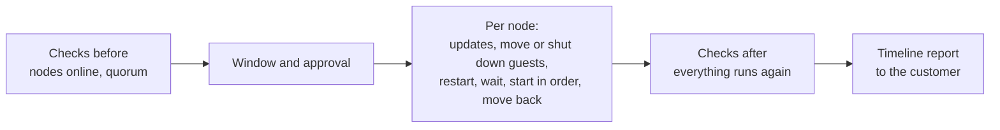

# Scheduled tasks and Proxmox maintenance

## Scheduled tasks

**Automation → Scheduled tasks** runs work on a schedule, with a safety net:

- container updates (`apt full-upgrade` or the community-script update), node updates, the template sync;
- your **own script**: a bash script for Linux and/or a PowerShell script for Windows. Every machine runs the script
  of its own operating system. On Windows `exit 99` means *not applicable here* and marks the machine as skipped.

### Make a task

1. Click **New task** and choose the kind and the targets (machines, containers or customers).
2. Set the schedule, for example *every Sunday at 03:00* (cron, with a time zone).
3. Switch on **snapshot first, roll back on failure** for containers, and the **mailed report**.
4. Save. **Run now** starts it straight away.

Every run is kept with its output per target.

## Proxmox maintenance

The task kind **Proxmox maintenance** patches the Proxmox VE nodes of one or more customers, **one cluster and one
node at a time**, for example every Saturday night at 01:45.

1. **Checks before**: every node online and the cluster quorate. A problem stops the maintenance before anything
   changes.
2. **Maintenance window and approval**: a scheduled run outside the customer's window does nothing. When the
   customer's policy (or the task) asks for approval, an admin gets a request and the run waits until the window
   closes. *Run now* always starts.
3. **Per node**: updates are installed. When a restart is needed (or always, your choice), running machines **move to
   another node** (live for VMs). A machine that can't move is **shut down cleanly**, in reverse start-up order. The
   node restarts; Stackpilot waits until it and the cluster are back, starts the machines in their **Proxmox start-up
   order**, and moves the others back. If a node doesn't come back, the rest of that cluster is left alone.
4. **Checks after**: every node online, quorum, and every machine that ran before runs again.

### The timeline report

Every step lands on a **timeline in plain words**, for example:

> 01:45 Checks done: 2 servers online, 14 machines running
> 01:52 pve1: 3 machines shut down cleanly
> 02:04 pve1 is back, machines started again

After the run every customer gets a **maintenance report** with that timeline, in its own language, at its
*maintenance report recipients* (Customer → Reports; empty means the monthly report's recipients), after every run or
only when something needs attention. The run also appears in the [change calendar](change-calendar.md) and in the
customer portal.

!!! tip "Try it with one customer first"
    Start with one customer whose cluster you know well, and watch the first run on the run page.
