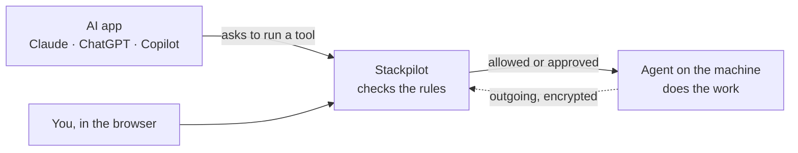

AI gateway · IT management · MSP

# Stackpilot

Stackpilot is one server from which you look after the IT of all your customers. A small program, the
**agent**, runs on every machine you manage and reports to Stackpilot. From one screen you see how everything is
doing, and you can let an AI assistant such as Claude, ChatGPT or Copilot do the work, within rules you set.

[Install Stackpilot](start/install.md){ .md-button .md-button--primary }
[What can it do?](#what-can-stackpilot-do){ .md-button }

## What kind of server is this?

Think of Stackpilot as the **control room** for the IT you manage. It is a web application that you install once,
on a Debian 13 server or container. After that:

- **Every customer has its own place.** Their Proxmox servers, Windows and Linux servers, PCs and laptops, UniFi
  network and Microsoft 365 all hang under that customer, so you never mix up who is who. Your own home or office
  network is simply a customer too ("Home").
- **Every machine reports in by itself.** The agent connects *outward* to Stackpilot over an encrypted connection.
  Nothing has to be opened in the customer's firewall and you need no VPN or remote-desktop tool per machine.
- **Your AI gets one connection for everything.** Stackpilot is an **MCP server** (MCP is the standard way AI apps
  use tools). Connect Claude, ChatGPT or Copilot once and ask: *"Check customer Acme: is anything wrong?"*,
  *"Install the updates on the web servers tonight"* or *"Why is this laptop slow?"*.
- **You stay in charge.** For every action you decide whether the AI may simply do it, must ask you first, or may
  never do it. Approvals come by mail and in the app, everything is logged, and one button pauses all AI actions.

## Who is it for?

For anyone who looks after IT for others: a **managed service provider (MSP)**, a freelance system administrator, or
the IT person of a company with several sites. And for your own lab or home network, with the same tools.

## What can Stackpilot do?

-   :material-office-building:{ .lg } **Customers central**

    ---

    Every machine, network, backup, ticket and invoice line belongs to a customer, with contacts, a maintenance
    window, an SLA and notes the AI reads before it works there. [Customers](customers/customers.md)

-   :material-robot:{ .lg } **AI gateway and MCP hub**

    ---

    One MCP endpoint with 230+ tools, policies per risk level, approvals, a kill switch and a full activity log.
    Bring your other MCP servers behind the same door. [Connect your AI](ai/connect.md)

-   :material-server:{ .lg } **Proxmox, servers and PCs**

    ---

    Proxmox VE clusters with VMs and containers, Linux and Windows servers, and workstations with inventory and a
    security status, all through the same agent. [Machines](machines/agents.md)

-   :material-weather-night:{ .lg } **Nightly checks**

    ---

    Every night every customer is checked. In the morning one summary with what is new and proposals you approve in
    one click. [Morning summary](automation/morning-summary.md)

-   :material-wrench-clock:{ .lg } **Runbooks, recovery and maintenance**

    ---

    Fixed procedures run step by step, known problems fix themselves, and Proxmox clusters are patched node by node
    with a timeline report. [Automation](automation/runbooks.md)

-   :material-backup-restore:{ .lg } **Backups**

    ---

    Which machine has a good backup, and which doesn't? Proxmox Backup Server, Veeam and Windows Server Backup in one
    overview, with restores after approval. [Customer backups](care/backups.md)

-   :material-heart-pulse:{ .lg } **Monitoring, uptime and SLA**

    ---

    Metrics and alerts, website and VPN checks, certificates, firewall changes and VPN tunnels, and the SLA you
    actually delivered. [Monitoring](care/monitoring.md)

-   :material-account-group:{ .lg } **Portal, docs and vault**

    ---

    A customer portal with tickets, documentation per customer and a password vault the AI can only use after your
    approval. [Portal and tickets](customers/portal-tickets.md)

-   :material-microsoft:{ .lg } **Microsoft 365, UniFi and GitHub**

    ---

    Entra ID users, MFA and risky sign-ins; UniFi networks, Fabrics and door access; a software library with
    deployments from GitHub. [Integrations](integrations/index.md)

-   :material-cash-multiple:{ .lg } **Costs and reports**

    ---

    A monthly statement per customer as the basis for invoicing, contracts that expire, and a monthly report in plain
    language for the customer. [Costs](customers/costs.md)

-   :material-email-fast:{ .lg } **Own mail server and backups**

    ---

    Your own SMTP server (TLS, DKIM) for every mail, and full and incremental backups of Stackpilot itself to FTP,
    FTPS, SFTP or SCP. [Administration](admin/mail.md)

-   :material-update:{ .lg } **Updates from the app**

    ---

    Info & updates shows the version, checks for updates, switches between production and test and installs with
    automatic rollback. [Updates](admin/updates.md)

## How does it work, in four steps?

1. **You, or your AI, ask for something**: a status, a log, an update, a restart.
2. **Stackpilot checks the rules**: may this AI connection reach this customer, what is the risk of this action, is
   it inside the customer's maintenance window, is the kill switch on?
3. **It runs, waits for you, or stops.** Safe actions run right away. Risky ones become an approval request in your
   mail and in the app. Forbidden ones are refused.
4. **The agent does the work** on the machine and the result is stored in the activity log, so you can always see who,
   or which AI, did what.

More detail in [How it works](reference/architecture.md).

## Where do I start?

1. [Install Stackpilot](start/install.md) on a Debian 13 server or container.
2. Follow the [first steps](start/first-steps.md): mail server, backup location, customers.
3. [Install the agent](machines/agents.md) on your first machines.
4. [Connect your AI](ai/connect.md) and set the [policies](ai/policies-approvals.md).

!!! tip "Help inside the app"
    The app has its own help under **Help & guides** (bottom of the left menu), with the exact MCP address of your
    install and step-by-step instructions for Claude, ChatGPT and Copilot. This site explains the same and more.

*Stackpilot is available in English and Dutch. Use the language button at the top to switch.*
