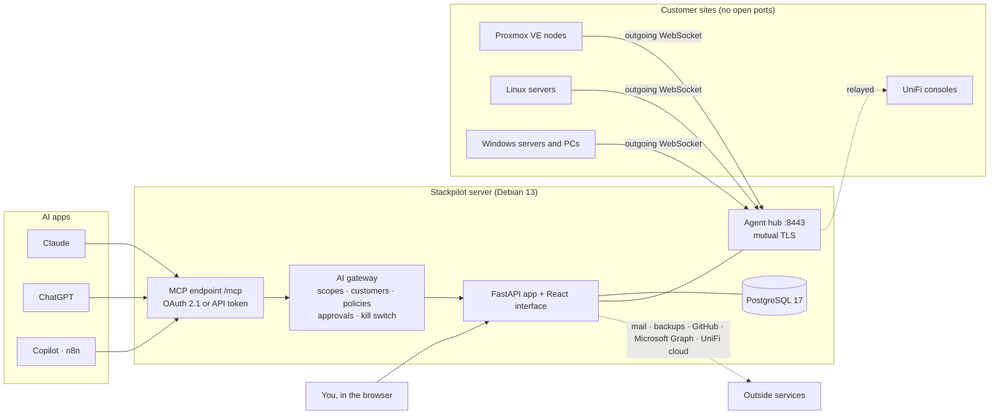

# How it works

## The parts

| Part | What it is |
| --- | --- |
| **Web app and API** | FastAPI on Python 3.13, running as a systemd service |
| **Interface** | React and TypeScript, built to static files and served by Nginx; English and Dutch, light and dark |
| **Database** | PostgreSQL 17 |
| **Web server** | Nginx: serves the interface, passes on the API, MCP and WebSockets, handles the agents' mutual TLS on 8443 |
| **MCP server** | Streamable HTTP at `/mcp`, with OAuth 2.1 (dynamic client registration, PKCE) or API tokens |
| **AI gateway** | Risk levels, policies, approvals, maintenance windows, kill switch, activity log |
| **Agent** | Go, no dependencies; `.deb` and binary for Linux (amd64/arm64), service and MSI for Windows |
| **Updater** | A separate privileged service that installs releases with a database backup and rollback |

Everything runs natively on Debian 13. There is no Docker.

## The agent connection

1. **Pairing**: a one-time code (valid 24 hours) is exchanged once for a client certificate from Stackpilot's own CA.
   The agent checks Stackpilot's identity with a pinned fingerprint.
2. **Connection**: the agent keeps one outgoing WebSocket open to port 8443, protected with mutual TLS. Both sides
   know exactly who the other is.
3. **Work**: Stackpilot sends jobs (read status, install updates, run a command) over that connection and gets the
   results back. The browser console, file copies, UniFi calls and MCP servers on the customer's network are relayed
   through the same connection.
4. **Reports**: the agent reports status and metrics every 20 seconds to a minute, and inventories every few hours.

Because the connection always starts at the machine, nothing has to be opened at the customer.

## An AI call, from question to result

1. The AI calls a tool on `/mcp` with its OAuth connection or API token.
2. The gateway checks the **scope**, the **customers**, the **kill switch**, the **policy** for the risk level and the
   **maintenance window**.
3. Allowed calls run at once. Calls that need approval answer *pending approval*: you get a mail and a notification,
   and after you approve, Stackpilot runs the call with the rights of that connection. Blocked calls are refused.
4. The agent does the work on the machine. The result and every argument are written to the activity log.

## Source code

Everything is in the [GitHub repository](https://github.com/rhisijmuiden/stackpilot): `backend/` (FastAPI),
`frontend/` (React), `agent/` (Go), `deploy/` (installer, Nginx, updater) and `branding/` (house style). A more
technical description is in
[docs/architecture.md](https://github.com/rhisijmuiden/stackpilot/blob/main/docs/architecture.md).
