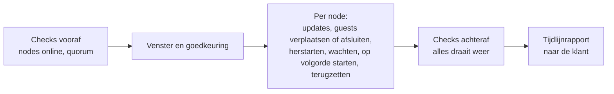

# Geplande taken en Proxmox-onderhoud

## Geplande taken

**Automatisering → Geplande taken** voert werk uit volgens een schema, met een vangnet:

- containerupdates (`apt full-upgrade` of de update van het community script), node-updates, het synchroniseren van
  templates;
- je **eigen script**: een bash-script voor Linux en/of een PowerShell-script voor Windows. Elke machine draait het
  script van zijn eigen besturingssysteem. Op Windows betekent `exit 99` *hier niet van toepassing* en wordt de machine
  overgeslagen.

### Een taak maken

1. Klik op **Nieuwe taak** en kies de soort en de doelen (machines, containers of klanten).
2. Stel het schema in, bijvoorbeeld *elke zondag om 03:00* (cron, met een tijdzone).
3. Zet voor containers **eerst een snapshot, terugdraaien bij een fout** aan, en het **rapport per mail**.
4. Sla op. **Nu uitvoeren** start de taak meteen.

Elke uitvoering wordt bewaard met de uitvoer per doel.

## Proxmox-onderhoud

De taaksoort **Proxmox-onderhoud** patcht de Proxmox VE-nodes van een of meer klanten, **één cluster en één node
tegelijk**, bijvoorbeeld elke zaterdagnacht om 01:45.

1. **Checks vooraf**: elke node online en het cluster heeft quorum. Een probleem stopt het onderhoud voordat er iets
   verandert.
2. **Onderhoudsvenster en goedkeuring**: een geplande uitvoering buiten het venster van de klant doet niets. Vraagt het
   beleid van de klant (of de taak) om goedkeuring, dan krijgt een beheerder een verzoek en wacht de uitvoering tot het
   venster sluit. *Nu uitvoeren* start altijd.
3. **Per node**: de updates worden geïnstalleerd. Is een herstart nodig (of altijd, jij kiest), dan **verhuizen** draaiende
   machines **naar een andere node** (live voor VM's). Een machine die niet kan verhuizen, wordt **netjes afgesloten**, in
   omgekeerde opstartvolgorde. De node herstart; Stackpilot wacht tot hij en het cluster terug zijn, start de machines in
   hun **Proxmox-opstartvolgorde** en zet de andere terug. Komt een node niet terug, dan blijft de rest van dat cluster
   ongemoeid.
4. **Checks achteraf**: elke node online, quorum, en elke machine die eerst draaide, draait weer.

### Het tijdlijnrapport

Elke stap komt op een **tijdlijn in gewone taal**, bijvoorbeeld:

> 01:45 Checks klaar: 2 servers online, 14 machines draaien
> 01:52 pve1: 3 machines netjes afgesloten
> 02:04 pve1 is terug, machines weer gestart

Na de uitvoering krijgt elke klant een **onderhoudsrapport** met die tijdlijn, in zijn eigen taal, op zijn *ontvangers
van onderhoudsrapporten* (Klant → Rapporten; leeg betekent de ontvangers van het maandrapport), na elke uitvoering of
alleen als er iets aandacht nodig heeft. De uitvoering staat ook in de [wijzigingskalender](change-calendar.md) en in het
klantportaal.

!!! tip "Probeer het eerst met één klant"
    Begin met één klant van wie je het cluster goed kent, en volg de eerste uitvoering op de pagina van de uitvoering.
