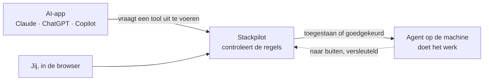

AI-gateway · IT-beheer · MSP

# Stackpilot

Stackpilot is één server waarmee je de IT van al je klanten beheert. Op elke machine die je beheert draait een klein
programma, de **agent**, dat zich bij Stackpilot meldt. Vanaf één scherm zie je hoe alles ervoor staat, en je kunt een
AI-assistent zoals Claude, ChatGPT of Copilot het werk laten doen, binnen regels die jij bepaalt.

[Stackpilot installeren](start/install.md){ .md-button .md-button--primary }
[Wat kan het?](#wat-kan-stackpilot){ .md-button }

## Wat voor server is dit?

Zie Stackpilot als de **meldkamer** voor de IT die je beheert. Het is een webapplicatie die je één keer installeert, op
een Debian 13-server of -container. Daarna:

- **Elke klant heeft zijn eigen plek.** Proxmox-servers, Windows- en Linux-servers, pc's en laptops, het UniFi-netwerk
  en Microsoft 365 hangen allemaal onder die klant, dus je haalt nooit klanten door elkaar. Je eigen thuis- of
  kantoornetwerk is gewoon ook een klant ("Home").
- **Elke machine meldt zich vanzelf.** De agent maakt zelf een versleutelde verbinding *naar buiten*, naar Stackpilot.
  Er hoeft niets open in de firewall van de klant en je hebt geen VPN of remote-desktoptool per machine nodig.
- **Je AI krijgt één koppeling voor alles.** Stackpilot is een **MCP-server** (MCP is de standaard waarmee AI-apps
  tools gebruiken). Koppel Claude, ChatGPT of Copilot één keer en vraag: *"Controleer klant Acme: is er iets mis?"*,
  *"Installeer vannacht de updates op de webservers"* of *"Waarom is deze laptop zo traag?"*.
- **Jij houdt de regie.** Per actie bepaal je of de AI het gewoon mag doen, het eerst aan jou moet vragen, of het nooit
  mag. Goedkeuringen komen per mail en in de app, alles wordt vastgelegd, en met één knop zet je alle AI-acties stil.

## Voor wie is het?

Voor iedereen die IT voor anderen beheert: een **managed service provider (MSP)**, een zelfstandig systeembeheerder of
de IT'er van een bedrijf met meerdere locaties. En voor je eigen lab of thuisnetwerk, met dezelfde gereedschappen.

## Wat kan Stackpilot?

-   :material-office-building:{ .lg } **Klanten centraal**

    ---

    Elke machine, elk netwerk, elke back-up, elk ticket en elke factuurregel hoort bij een klant, met contactpersonen,
    een onderhoudsvenster, een SLA en notities die de AI leest voordat hij daar aan de slag gaat.
    [Klanten](customers/customers.md)

-   :material-robot:{ .lg } **AI-gateway en MCP-hub**

    ---

    Eén MCP-adres met meer dan 230 tools, beleid per risiconiveau, goedkeuringen, een noodstop en een volledig
    activiteitenlog. Zet je andere MCP-servers achter dezelfde deur. [Je AI koppelen](ai/connect.md)

-   :material-server:{ .lg } **Proxmox, servers en pc's**

    ---

    Proxmox VE-clusters met VM's en containers, Linux- en Windows-servers, en werkplekken met inventaris en een
    beveiligingsstatus, allemaal via dezelfde agent. [Machines](machines/agents.md)

-   :material-weather-night:{ .lg } **Nachtelijke checks**

    ---

    Elke nacht wordt elke klant gecontroleerd. 's Ochtends één samenvatting met wat nieuw is en voorstellen die je met
    één klik goedkeurt. [Ochtendsamenvatting](automation/morning-summary.md)

-   :material-wrench-clock:{ .lg } **Runbooks, herstel en onderhoud**

    ---

    Vaste procedures stap voor stap, bekende problemen die zichzelf oplossen, en Proxmox-clusters die node voor node
    gepatcht worden met een tijdlijnrapport. [Automatisering](automation/runbooks.md)

-   :material-backup-restore:{ .lg } **Back-ups**

    ---

    Welke machine heeft een goede back-up, en welke niet? Proxmox Backup Server, Veeam en Windows Server Backup in één
    overzicht, met terugzetten na goedkeuring. [Klantback-ups](care/backups.md)

-   :material-heart-pulse:{ .lg } **Monitoring, uptime en SLA**

    ---

    Metingen en meldingen, checks van websites en VPN's, certificaten, firewallwijzigingen en VPN-tunnels, en de SLA
    die je echt geleverd hebt. [Monitoring](care/monitoring.md)

-   :material-account-group:{ .lg } **Portaal, documentatie en kluis**

    ---

    Een klantportaal met tickets, documentatie per klant en een wachtwoordkluis die de AI alleen na jouw goedkeuring
    kan gebruiken. [Portaal en tickets](customers/portal-tickets.md)

-   :material-microsoft:{ .lg } **Microsoft 365, UniFi en GitHub**

    ---

    Entra ID-gebruikers, MFA en riskante aanmeldingen; UniFi-netwerken, Fabrics en deurtoegang; een
    softwarebibliotheek met deployments vanuit GitHub. [Koppelingen](integrations/index.md)

-   :material-cash-multiple:{ .lg } **Kosten en rapporten**

    ---

    Een maandoverzicht per klant als basis voor je factuur, contracten die aflopen, en een maandrapport in gewone taal
    voor de klant. [Kosten](customers/costs.md)

-   :material-email-fast:{ .lg } **Eigen mailserver en back-ups**

    ---

    Je eigen SMTP-server (TLS, DKIM) voor alle mail, en volledige en incrementele back-ups van Stackpilot zelf naar
    FTP, FTPS, SFTP of SCP. [Beheer](admin/mail.md)

-   :material-update:{ .lg } **Updaten vanuit de app**

    ---

    Info & updates toont de versie, zoekt naar updates, wisselt tussen productie en test en installeert met
    automatisch terugdraaien. [Updates](admin/updates.md)

## Hoe werkt het, in vier stappen?

1. **Jij, of je AI, vraagt iets**: een status, een log, een update, een herstart.
2. **Stackpilot controleert de regels**: mag deze AI-koppeling bij deze klant, hoe riskant is deze actie, valt het
   binnen het onderhoudsvenster van de klant, staat de noodstop aan?
3. **Het wordt uitgevoerd, wacht op jou, of stopt.** Veilige acties gaan meteen. Riskante worden een
   goedkeuringsverzoek in je mail en in de app. Verboden acties worden geweigerd.
4. **De agent doet het werk** op de machine en het resultaat komt in het activiteitenlog, zodat je altijd ziet wie, of
   welke AI, wat gedaan heeft.

Meer in [Hoe het werkt](reference/architecture.md).

## Waar begin ik?

1. [Installeer Stackpilot](start/install.md) op een Debian 13-server of -container.
2. Volg de [eerste stappen](start/first-steps.md): mailserver, back-uplocatie, klanten.
3. [Installeer de agent](machines/agents.md) op je eerste machines.
4. [Koppel je AI](ai/connect.md) en stel het [beleid](ai/policies-approvals.md) in.

!!! tip "Help in de app"
    De app heeft zijn eigen help onder **Help & handleidingen** (onderaan het linkermenu), met het precieze MCP-adres
    van jouw installatie en stap-voor-stap-uitleg voor Claude, ChatGPT en Copilot. Deze site legt hetzelfde uit, en meer.

*Stackpilot is er in het Engels en het Nederlands. Wissel van taal met de taalknop bovenaan.*
