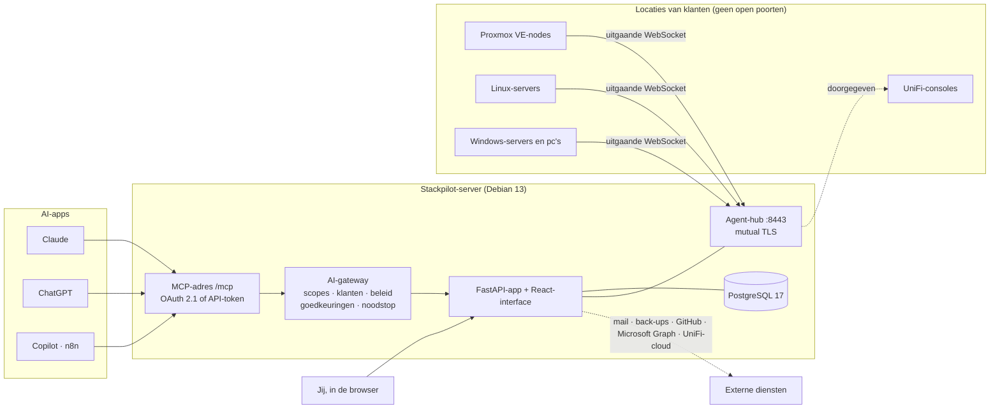

# Hoe het werkt

## De onderdelen

| Onderdeel | Wat het is |
| --- | --- |
| **Webapp en API** | FastAPI op Python 3.13, draait als systemd-service |
| **Interface** | React en TypeScript, gebouwd tot statische bestanden en geserveerd door Nginx; Engels en Nederlands, licht en donker |
| **Database** | PostgreSQL 17 |
| **Webserver** | Nginx: serveert de interface, geeft API, MCP en WebSockets door, handelt de mutual TLS van de agents af op 8443 |
| **MCP-server** | Streamable HTTP op `/mcp`, met OAuth 2.1 (dynamische clientregistratie, PKCE) of API-tokens |
| **AI-gateway** | Risiconiveaus, beleid, goedkeuringen, onderhoudsvensters, noodstop, activiteitenlog |
| **Agent** | Go, geen afhankelijkheden; `.deb` en binary voor Linux (amd64/arm64), service en MSI voor Windows |
| **Updater** | Een aparte service met verhoogde rechten die releases installeert, met databaseback-up en terugdraaien |

Alles draait native op Debian 13. Er is geen Docker.

## De verbinding van de agent

1. **Koppelen**: een eenmalige code (24 uur geldig) wordt één keer ingeruild voor een clientcertificaat van de eigen CA
   van Stackpilot. De agent controleert de identiteit van Stackpilot met een vastgezette vingerafdruk.
2. **Verbinding**: de agent houdt één uitgaande WebSocket open naar poort 8443, beveiligd met mutual TLS. Beide kanten
   weten precies wie de ander is.
3. **Werk**: Stackpilot stuurt taken (status lezen, updates installeren, een commando draaien) over die verbinding en
   krijgt de resultaten terug. De console in de browser, bestandskopieën, UniFi-verzoeken en MCP-servers in het netwerk
   van de klant gaan via dezelfde verbinding.
4. **Rapporteren**: de agent meldt status en metingen elke 20 seconden tot een minuut, en de inventaris elke paar uur.

Omdat de verbinding altijd bij de machine begint, hoeft er bij de klant niets open.

## Een AI-aanroep, van vraag tot resultaat

1. De AI roept een tool aan op `/mcp`, met zijn OAuth-koppeling of API-token.
2. De gateway controleert de **scope**, de **klanten**, de **noodstop**, het **beleid** voor het risiconiveau en het
   **onderhoudsvenster**.
3. Toegestane aanroepen gaan meteen. Aanroepen die goedkeuring nodig hebben, antwoorden *wacht op goedkeuring*: jij
   krijgt een mail en een melding, en na jouw goedkeuring voert Stackpilot de aanroep uit met de rechten van die
   koppeling. Geblokkeerde aanroepen worden geweigerd.
4. De agent doet het werk op de machine. Het resultaat en elk argument komen in het activiteitenlog.

## Broncode

Alles staat in de [GitHub-repository](https://github.com/rhisijmuiden/stackpilot): `backend/` (FastAPI), `frontend/`
(React), `agent/` (Go), `deploy/` (installer, Nginx, updater) en `branding/` (huisstijl). Een meer technische
beschrijving staat in [docs/architecture.md](https://github.com/rhisijmuiden/stackpilot/blob/main/docs/architecture.md)
(Engels).
